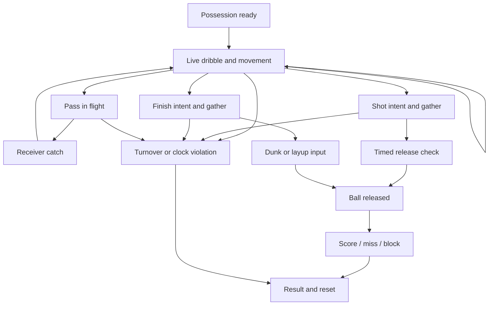

# Gesture and possession design

All mappings and timing values below are design hypotheses. They have not been tested on a phone.

## Portrait input options

Portrait is confirmed. One-thumb versus two-thumb operation is not confirmed. Compare two portrait designs before committing:

| Option | Mechanism | Benefit | Cost |
|---|---|---|---|
| A — gesture-led movement | One large lower-screen gesture pad; explicit drive gestures select a direction; the player travels a bounded distance then returns to controllable dribbling | Strong connection to the owner's swipe idea; less visual clutter | Less continuous positional control; danger of feeling on rails |
| B — compact two-thumb | Small movement area lower left; dribble pad lower right; adjacent shot/finish and pass controls | Independent steering and ball manipulation | Fingers occupy more of a narrow screen |

Recommend storyboarding A first, while retaining B as a serious comparison. Do not mistake portrait orientation for an owner decision to use only one thumb. Neither design should place a permanent pad over the ball or feet.

## Gesture vocabulary proposal

Directions are screen-relative inside a stable touch pad. Translate into court intent using an orientation basis captured when the gesture starts. A camera transition must not reverse its meaning.

| Gesture in dribble pad | Proposed basketball intent | Disambiguation |
|---|---|---|
| Short lateral stroke toward opposite hand | Front crossover | Current hand is known; diagonal gestures occupy distinct sectors |
| Down-diagonal toward opposite hand | Between-legs transfer | Require sufficient vertical travel |
| Shallow lower arc | Behind-back transfer | Arc classification; do not also emit a straight stroke |
| Short outward stroke toward current hand | Hesitation / hang | Different from opposite-hand crossover |
| Out-and-back path | Same-hand inward feint and return | Require a reversal; never retroactively undo an already committed crossover |
| Forward diagonal | Attack that lane | Only in gesture-led movement; two-thumb layout uses steering instead |
| Straight retreat stroke | Pullback while preserving dribble | Shooting requires separate shot intent |
| Larger circular path | Spin | Later vocabulary; sufficient travel and curvature needed |

Keep shot initiation in a distinct visible touch target. A touch beginning inside that target belongs to shooting until it ends. A touch beginning in the dribble pad must not become a shot because it passes over the target. The same rule applies to the teammate target.

Recognize a short core vocabulary reliably before assigning dozens of gestures. Extra variations should come from movement context, pace, stance, and deliberate chaining, not an unmemorable alphabet of shapes.

## Recognition requirements

Record touch identity, start position, timestamped path, travel, direction, duration, curvature, reversals, and touch end/cancel. Normalize distances to the usable gesture area, not fixed pixels. Device DPI is a hint rather than a guaranteed physical measurement.

Use a small dead zone to ignore hand jitter. Distinguish a direct stroke from an arc by the full path. For gestures sharing a prefix, wait for a clear branch or touch end before committing; optional anticipation poses can acknowledge input immediately. Do not fire a crossover and later reinterpret it as an in-and-out.

Use a short one-command buffer for the next valid transition, initially exploring approximately 80–140 milliseconds. These are starting values, not measured requirements. Expire stale commands; do not queue a long sequence the player can no longer control. Never duplicate an action on touch-up after committing it earlier.

When uncertain, preserve the current dribble and give restrained feedback. Do not turn a recognition failure into a random flashy move or unexplained turnover. Basketball consequences belong to an accepted action's timing, spacing, and execution.

## Chaining

Each action has entry conditions, commitment, allowed branch points, and recovery. The next action must be compatible with the current hand, support foot, speed, and live-dribble state. A slow hesitation can flow into an explosive attack; a planted retreat can flow into a crossover; an airborne player cannot return to a standing dribble.

Useful sequences to specify first:

1. Hesitation → crossover → drive → basic layup.
2. Crossover → retreat → stepback jumper.
3. Between-legs transfer → attack → stop → midrange pull-up.
4. Inward feint → same-side burst → dunk gather → finish gesture.
5. Failed separation → protect → double-tap pass → control switches → receiver attacks a closeout.
6. Pass to the wing → control switches to that wing → call return alley-oop → original passer cuts → lob and timed finish.

## Passing and return alley-oops

**Owner-confirmed:** double-tap left or right to pass to that teammate. A completed catch switches control to the receiver. Swipe diagonally down from the upper-left or upper-right teammate region to request an alley-oop involving that edge. The special alley-oop command handles the return action even though ordinary passes switch control.

**Recommended interpretation:** with possession in the center, the upper-side gesture is a give-and-go command: pass to the selected wing, send the original player on a cut, have the wing return a lob, and transfer control to the airborne finisher for the skill check. After an ordinary wing pass, the same command can request the return lob to the previous passer if that player is eligible. This command routes the play; it does not guarantee a catch or score. The precise indicator layout needs storyboard validation.

An alternate implementation would require an explicit first double-tap pass before the lob command. Compare both in a storyboard. Do not silently interpret the owner's downward gesture as a standard upward dunk swipe: the starting region and possession phase separate their meanings.

Keep visible, generously sized teammate anchors inside the safe screen area, below operating-system edge gestures. A gesture beginning on a teammate anchor is reserved for passing or the lob call. The central/lower dribble pad owns between-legs diagonal gestures. A teammate stroke must never trigger both an alley-oop and a between-legs move.

Proposed double-tap recognition: explore a 220–300 ms interval and a normalized spatial tolerance within the same teammate target. A first tap highlights the teammate; it does not pass. A qualifying second tap commits one pass. A drag exceeding the threshold cancels the tap sequence and enters the side-gesture classifier. These values are untested. Provide a single-tap pass-button accessibility option with equivalent basketball consequences.

Select the teammate identity when the gesture starts, and keep that identity stable until the command resolves. Avoid left/right labels flipping as the camera moves. On a pass in flight, show the intended receiver but transfer playable control only on a valid catch. Interceptions transfer to the result state. A dropped catch does not silently hand control to an attacker who never possessed the ball.

Alley-oop states: request → receiver cut and passer preparation → lob release → ball flight and takeoff → catch/finish skill check → rim outcome → landing. The clock runs throughout. Before lob release, a blocked route can abort back to legal ball possession. After release, resolve the actual flight: catch, deflection, interception, missed connection, or finish. No teleporting the ball or receiver.

Passing rating influences lob delivery tolerance. Finishing rating, stamina, approach, reach, and defensive contact influence receiver eligibility and timing tolerance. A skill check evaluates the finish; ratings cannot make a physically impossible catch succeed. Use one finish timing check rather than separate precision checks for pass, catch, and dunk. See document 10.

Repeated attempts cost time and stamina. Longer strings are not automatically stronger. The move's exit should matter more than its length.

## Possession states

The diagram omits detailed recovery states for readability. Gather completion ends the live dribble. A shooting fake after picking up the ball permits a legal pivot, pass, or shot, not another dribble. A pre-gather hesitation is a different action from that pump fake.

## Shot intent

Initial proposal: tap Shot to begin the gather, then make one new tap to stop a visible timing indicator in an okay or perfect band. A later control comparison can test press-and-release instead. Do not require both a precision swipe and an unrelated precision tap for a basic jumper without evidence that players enjoy it.

The animation and skill check share one timeline. The release occurs at the evaluated input time or a clearly specified failure deadline. A camera change never restarts the check. Full accuracy, stamina, contest, and upgrade rules are in document 10.

## Two-stage finishing

Finish intent near the rim starts a valid gather only if speed, distance, reach, stamina, and free space permit. A dunk is not available simply because the player pressed the control. A blocked path may lead to a contested layup option or a denied gather with clear feedback.

At gather entry, consume the old dribble command and visibly activate the finish pad. Require a fresh touch after the prior stroke ends; give an identical input window in both camera settings. Begin the window during the gather, not after a surprising camera cut. Preserve a minimum readable lead-in in simulation time.

Proposed early dunk grammar: an upward stroke for a secure two-hand finish; an up-left or up-right stroke for the available one-hand finish. Later arcs can select a windmill and larger rotation paths can select a spinning finish. These shapes are proposals, not a complete accepted control set. Physics and body state restrict available choices.

A valid direction selects style; stroke completion timing determines execution quality. For the first design, do not add a second independent dunk timing tap. An invalid or absent gesture before the deadline produces an explicitly defined basic attempt or a miss depending on assistance mode; do not award a difficult dunk automatically. A late defensive contest remains relevant until release or rim contact.

Owner addition: after dunk selection and takeoff, a fresh tap can request a layup conversion. This tap is a change of intent, not automatically another precision timing check. Select a compatible bridge from the current hand/ball/body pose and remaining flight. See document 20 for routing and unresolved timing-check interaction. Euro steps and post offense are excluded.

## Clock and scoring rules

Recommend a 12-second arcade possession for early design, with untimed practice and a longer option. This is our rule choice. Start the clock when control begins, after setup. Passing, camera transitions, gathers, and skill checks do not reset it.

A shot must leave the hand before expiry. If it is already airborne at the buzzer, wait for the result: a made basket counts; rim contact resolves as a miss if no rebound phase exists; a rimless miss after expiry is a violation. A dunk needs its authoritative scoring/release event before expiry; takeoff alone is insufficient. Specify exact event ordering at the boundary using timestamps rather than rounded displayed seconds.

The first playable should end on the first resolved shot, block, lost possession, out-of-bounds, or violation. Rebounds, fouls, free throws, and possession resets can be added later with their full rule consequences.

## Interruptions and accessibility

Pause single-player play on backgrounding and cancel incomplete touches. Resume with a short readiness cue rather than advancing the clock invisibly. Support left/right control placement, adjustable sensitivity, larger targets, haptic intensity, reduced motion, and redundant shape/text feedback for timing zones. A camera setting never changes control difficulty.
